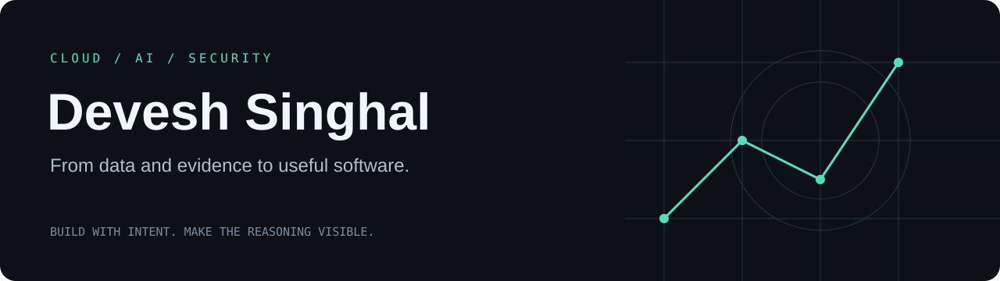
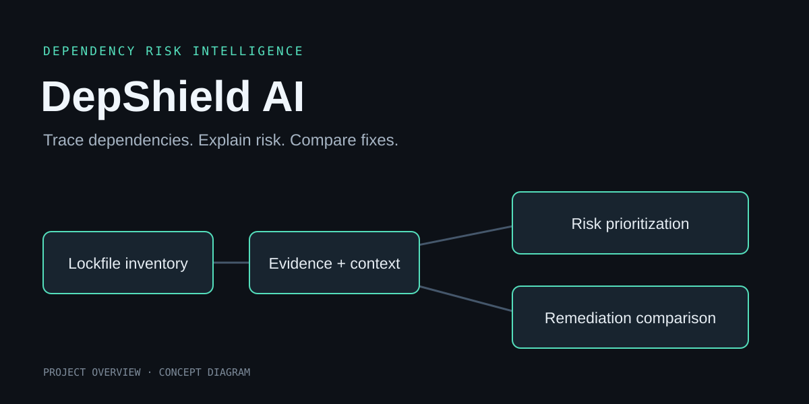

  

  
  
  

<a href="#-about-me">About</a> · <a href="#selected-projects">Projects</a> · <a href="#-tech-stack">Technology</a> · <a href="#-github-activity">Activity</a> · <a href="#problem-solving">Problem solving</a> · <a href="#connect">Connect</a>

## 👨‍💻 About me

I'm **Devesh Singhal**. My work brings together **cloud infrastructure, applied AI, and security-focused software**—from comparing travel exposure to exploring connected evidence and understanding dependency risk.

I enjoy turning complex data into something people can inspect and use: a route comparison, an investigation graph, an analyst workspace, or an explanation of why a dependency needs attention.

- **Currently building:** cloud-connected applications, explainable AI workflows, and security investigation tools.
- **Interested in:** API architecture, serverless systems, graph-based reasoning, and grounded AI.
- **Engineering mindset:** Build → Test → Understand → Improve.

I care about interfaces that make complex systems understandable, explanations tied to evidence, and documentation that makes assumptions and tradeoffs clear.

## Selected projects

### 01 / EcoRoute AI
**Pollution-aware journeys, with transparent comparisons.**

A team-built, AWS-native journey planner that compares real road routes, travel time, and estimated PM2.5 exposure. It combines environmental forecasts with deterministic scoring and grounded AI explanations.

- Preserves routing-provider geometry and the provenance of environmental data.
- Compares fastest, lowest estimated exposure, and balanced route options.
- Includes consent and ownership controls for optional wearable integration.

`React` `TypeScript` `Python` `FastAPI` `AWS` `CDK`

[Repository](https://github.com/deveshsinghal09/ecoroute-ai) · [Live Demo](https://main.d3txif33djiy59.amplifyapp.com/) · [Walkthrough](https://youtu.be/4XNr6BEzIzI)

Repository screenshot. Exposure estimates are environmental comparisons, not medical-risk measurements.

---

### 02 / ShadowChain AI
**Connected evidence. Persistent investigation context.**

A graph-powered security investigation platform with a React and Three.js explorer. FalkorDB connects repository evidence with agent observations, tasks, decisions, and handoffs.

- Explores entities, relationships, and bounded paths through a visual graph.
- Preserves investigation context so agents can resume unfinished work.
- Supports modeled what-if analysis without changing live permissions.

`React` `TypeScript` `Three.js` `Python` `FastAPI` `FalkorDB`

[Repository](https://github.com/deveshsinghal09/shadowchain-ai) · [Live Demo](https://shadowchain-ai.vercel.app/)

---

### 03 / Sentinel AML
**Explainable investigations, backed by an auditable workflow.**

A team-built anti-money-laundering investigation workspace that turns natural-language questions into selective analytical plans. It combines rules, statistical signals, anomaly detection, and graph analysis with evidence-linked explanations and human review.

**My contribution — AWS and cloud integration:** S3, DynamoDB, Lambda, API Gateway, CloudWatch, and SNS for storage, processing, API delivery, monitoring, and high-risk alert workflows; cloud setup and deployment support.

`AWS` `Python` `FastAPI` `React` `TypeScript` `DuckDB` `scikit-learn`

[Repository](https://github.com/deveshsinghal09/Sentinel-AML-Platform) · [Live Demo](https://sentinel-aml-demo-frontendbucket-aqfdpzq4srwb.s3.ap-south-1.amazonaws.com/index.html#/) · [Cloud architecture](https://github.com/deveshsinghal09/Sentinel-AML-Platform/blob/main/AWS_DEPLOYMENT.md)

Decision support with mandatory human review; risk scores are investigative signals.

---

### 04 / DepShield AI
**Dependency risk explained in the context of a project.**

A dependency risk console for Node.js projects that joins npm audit and OSV advisories with lockfile topology, bounded static analysis, and explainable scoring.

- Shows why a dependency is prioritized through an evidence and factor ledger.
- Compares remediation scenarios, persisted scans, and changes in findings.
- Includes policy gates, SBOM export, and a controlled local attack-replay fixture.

`Next.js` `TypeScript` `SQLite` `OSV` `npm audit` `Gemini`

[Repository](https://github.com/deveshsinghal09/DepShield)

## 💻 Tech stack

Technologies used across my projects.

**Languages**

  

**Frontend**

  

**Backend and data**

     

**AI and analysis**

  

**Cloud and development**

       

## 📊 GitHub activity

  
  

  

Cards request data for deveshsinghal09; no counts are hard-coded. Third-party services may be cached or temporarily unavailable. Language proportions describe repository code, not proficiency. GitHub's contribution calendar below provides native activity history.

## Problem solving

Alongside project work, I use coding problems to sharpen my understanding of algorithms and data structures.

**[LeetCode →](https://leetcode.com/u/Devesh_Singhal09/)** &nbsp; **[Codolio →](https://codolio.com/profile/devesh_singhal)**

## Connect

Interested in cloud, AI, security, or building something together? **[Let's connect on LinkedIn.](https://www.linkedin.com/in/devesh-singhal-7b9a07427/)**

Useful software. Clear evidence. Thoughtful engineering.

